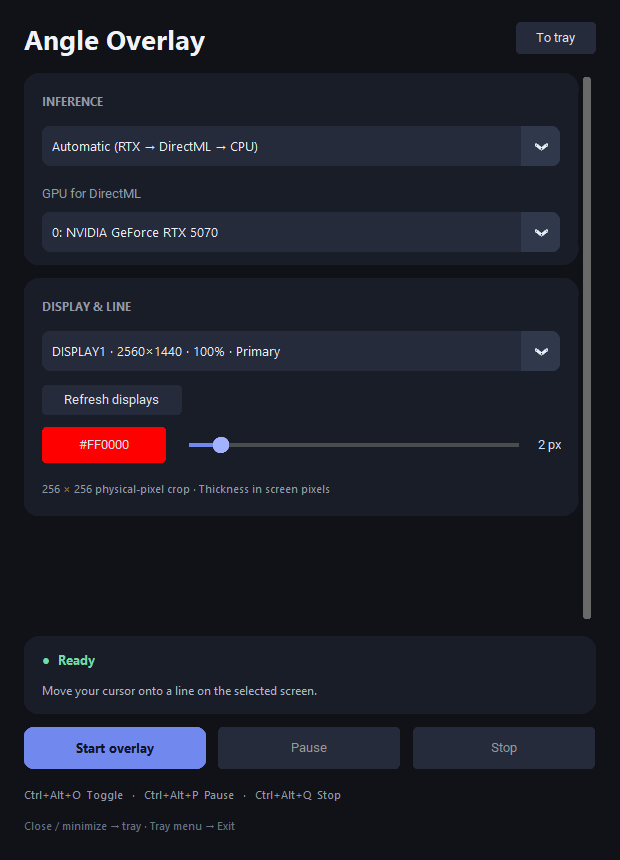

# Angle Overlay

[English](README.md)

Наведите курсор на линию, чтобы увидеть её продолжение через весь экран.
Она отображается поверх окон и не мешает кликам.

## Быстрый старт

Скачайте Windows x64 ZIP в **Releases → Assets**, распакуйте папку целиком
и откройте **AngleOverlay.exe**. Выберите экран и нажмите **Start overlay**.
Устанавливать Python или CUDA Toolkit не нужно.

- NVIDIA RTX, AMD/Intel через DirectML и вычисления на CPU.
- Несколько мониторов, разные масштабы Windows и портретные экраны.
- **Ctrl+Alt+O** — включить/выключить; **Ctrl+Alt+P** — пауза; **Ctrl+Alt+Q** — остановка.
- Закрытие и сворачивание настроек убирает их в трей; полный выход — через его меню.
- Изображения обрабатываются локально, скриншоты не сохраняются и не отправляются по сети.

## Документация

| | Русский | English |
|---|---|---|
| Использование приложения | [Руководство пользователя](USER-GUIDE.ru.md) | [User guide](USER-GUIDE.md) |
| Архитектура и реализация | [Техническая документация](TECHNICAL.ru.md) | [Technical documentation](TECHNICAL.md) |

Исходный код приложения распространяется по [Apache License 2.0](LICENSE).
Сведения о сторонних компонентах и происхождении модели приведены в [NOTICE](NOTICE)
и технической документации.
